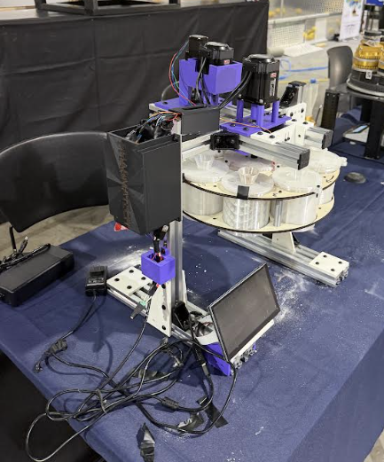

# Team Pharmatech

Boilerplate repository structure for a pill compounding machine project.

| CAD model | Real device — isometric view |
| --- | --- |
|  |  |

## Top-level areas
- `cad/` - mechanical and enclosure design files
- `firmware/` - embedded software and configuration
- `electronics/` - schematic, PCB, and component documentation
